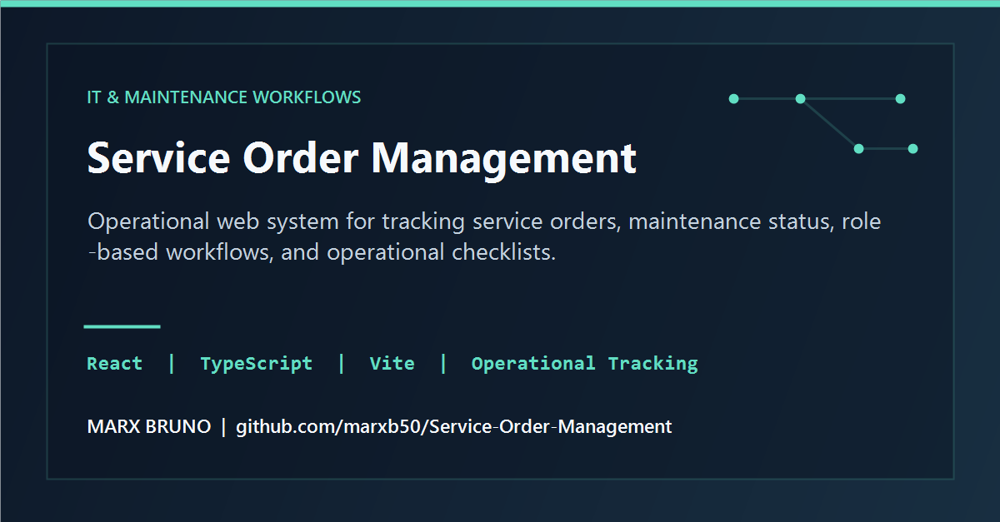

# Service Order Management

Sistema full-stack para registrar, acompanhar, aprovar e auditar ordens de serviço executadas em campo.

O projeto demonstra a transformação de um fluxo operacional com fotos, localização, diferentes responsáveis e conferência em uma aplicação web rastreável. Dados reais, credenciais e arquivos de produção não fazem parte deste repositório.

## Fluxo operacional

```text
SELIM cria a ordem
        ↓
Funcionário registra início + foto + geolocalização
        ↓
SELIM revisa e aprova ou devolve
        ↓
Funcionário conclui o serviço
        ↓
MB confere o resultado
        ↓
Relatório + histórico de auditoria
```

## Capacidades

- autenticação com sessão HTTP-only e papéis `ADMIN`, `FUNCIONARIO`, `SELIM` e `MB`;
- cadastro e aprovação de usuários;
- ciclo de estados de ordens de serviço;
- captura de localização e compressão de imagens no navegador;
- armazenamento de mídia no Cloudinary;
- filtros, indicadores operacionais e relatório HTML pronto para impressão;
- log de criação, início, aprovação, rejeição, conferência e alterações administrativas;
- validação de formulários com Zod;
- persistência PostgreSQL com Prisma.

## Stack

- Next.js 15 e React 19
- TypeScript
- PostgreSQL e Prisma
- Tailwind CSS
- JWT com `jose`
- bcrypt
- Cloudinary
- Zod

## Modelo de dados

O domínio principal está em [`prisma/schema.prisma`](prisma/schema.prisma):

- `Usuario`: identidade, papel e estado da conta;
- `Servico`: ordem, responsável, fotos, coordenadas, datas e aprovações;
- `Log`: trilha de auditoria;
- `Config`: parâmetros operacionais.

## Executar localmente

Requer Node.js 20+, PostgreSQL e uma conta Cloudinary para o fluxo completo de imagens.

```bash
cp .env.example .env
npm ci
npx prisma migrate dev
npx prisma db seed
npm run dev
```

Abra `http://localhost:3000`.

### Variáveis obrigatórias

```env
DATABASE_URL="postgresql://..."
JWT_SECRET="uma-chave-aleatoria-com-pelo-menos-32-caracteres"
NEXT_PUBLIC_CLOUDINARY_CLOUD_NAME=""
CLOUDINARY_API_KEY=""
CLOUDINARY_API_SECRET=""
NEXT_PUBLIC_APP_URL="http://localhost:3000"
SEED_ADMIN_PASSWORD="senha-local-com-12-ou-mais-caracteres"
SEED_SELIM_PASSWORD="senha-local-com-12-ou-mais-caracteres"
SEED_MB_PASSWORD="senha-local-com-12-ou-mais-caracteres"
```

O sistema não contém senha administrativa padrão nem rotas públicas de manutenção. Usuários iniciais para desenvolvimento devem ser criados pelo seed local e nunca reutilizados em produção.

## Estrutura

```text
src/
├── actions/              # regras e transições do domínio
├── app/                  # páginas e rotas do Next.js
├── components/dashboard/ # interface operacional
└── lib/                  # autenticação, banco, mídia e utilitários
prisma/
├── schema.prisma
└── seed.ts
```

Desenvolvido por [Marx Bruno](https://github.com/marxb50).
